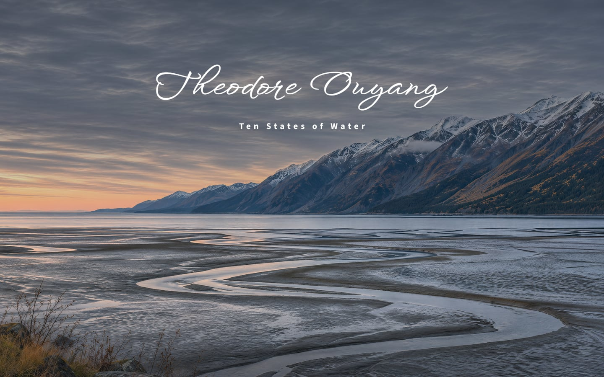
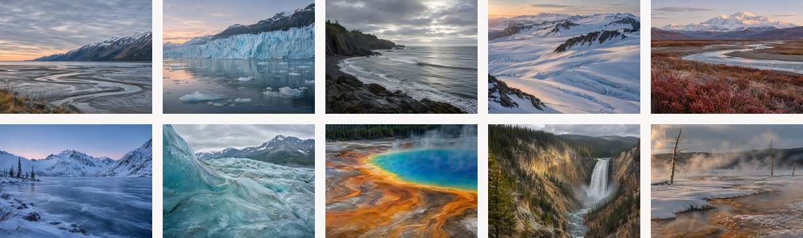
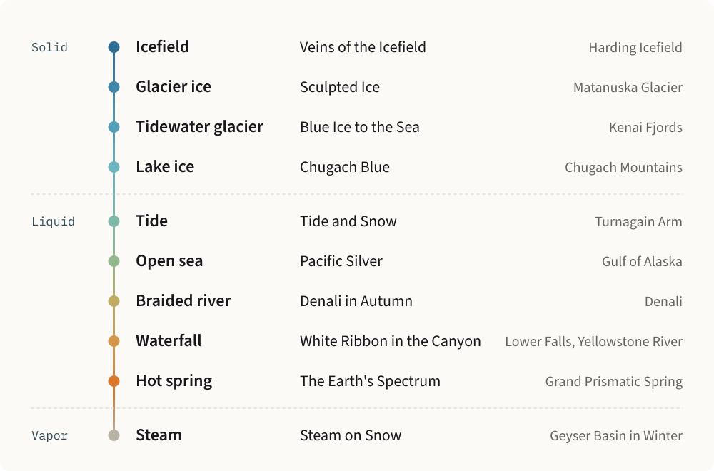
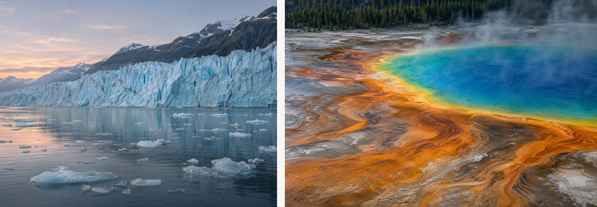
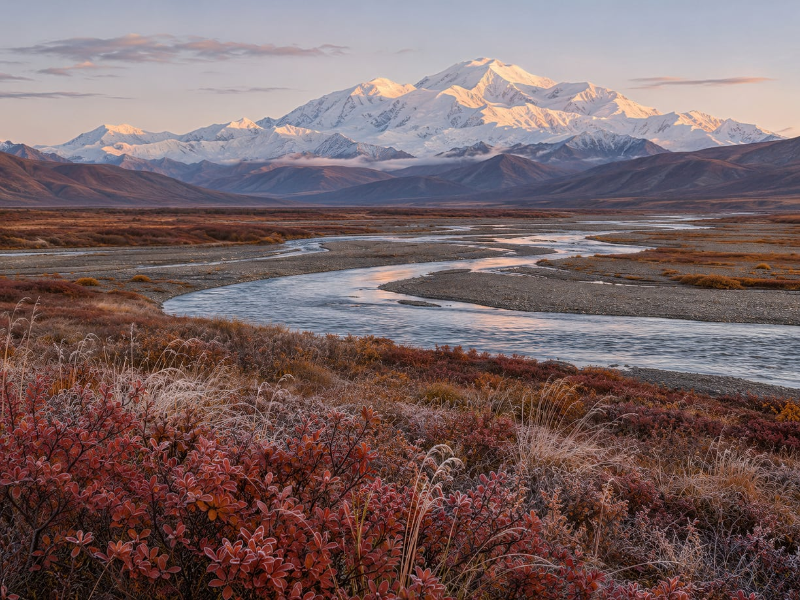

# Ten States of Water

> "Nothing under heaven is softer or weaker than water, yet nothing that attacks the hard and strong can surpass it."
>
> Laozi, *Tao Te Ching*, ch. 78

**Ten landscapes of Alaska and Yellowstone, with water in a different state in each.**

**[View the work](https://www.theodoreoy.com/ten-states-of-water/)**

When I think of Alaska and Yellowstone, I think of water. This series is the picture that forms in my mind. It arrives as tide, stands as a glacier, lies frozen on a lake, falls through a canyon, and leaves a hot spring as steam.

## The Idea

Water is the softest thing in these landscapes and the one that made them. The glacier carves the fjord, the river opens the canyon, the tide draws its channels through the mud, and the spring lays down its own terraces. I built the series on that reversal, so every hard shape in it can be traced to the water in the frame.

## The Logic of the Series

One rule governs the selection: no state of water appears twice. Ordered by state, the ten works read as a single passage from ice to vapor. Alaska holds the cold end. Yellowstone answers with a waterfall, a hot spring, and steam lifting off snow.

## The Frame

I set Alaska in 4:3 and Yellowstone in 3:2. The squarer frame gives the northern sky room above the ice. The longer frame runs across a spring and down a canyon, so the ground carries the picture and the sky can almost disappear. Inside the albums every image keeps its full proportions.

## The Name

The cover is one frame, and the lettering is its single gesture: my name writes itself letter by letter into the open sky above the ridge. On a phone the frame is cut to 2:3 around the point where the mountains meet the light, which keeps the sunset, the snow line, and the channel in one column.

## The Readings

A landscape is finished by the way it is looked at, so every image keeps a reading beside it: about sixty words on where the eye goes, how the light falls, and what holds the frame together. On a wide screen the reading stays in view while its image passes, so the two are read at once.

*Denali in Autumn.* Three registers stack with classical clarity: frosted tundra in crimson, a braided river in steel and rose, and the massif lit far above its dark foothills.

## Credits

The name is drawn from WindSong by Robert Leuschke (SIL Open Font License). Text is set in Roboto, Roboto Condensed, and Source Sans 3.

Images are &copy; Theodore Ouyang. All rights reserved.
